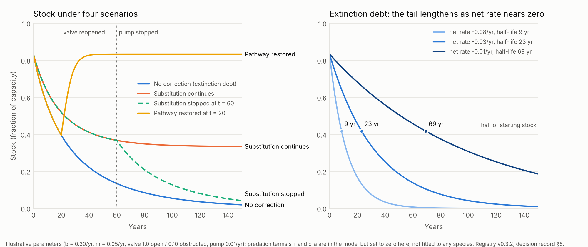

# Definition decisions — 30 October 2026

## Publication scope

Registry v0.3.2 is an **additive** revision. It registers definitions that the
[Ohio–Mississippi freshwater-mussel worked example](../Examples/ohio-mississippi-mussels/ohio-mississippi-mussels-worked-example.md)
(§8) showed the corpus could not yet express, together with a
cross-basin analog from the Yangtze. No v0.3.1 definition is changed. Papers
reconciled to v0.3.1 remain valid as written; they inherit the additions below
through the [registry](causal-ethics-master-symbol-registry.md).

As in the [16 October record](definition-decisions-2026-10-16.md), adopting a
definition is a convention for this corpus. It is not evidence that the
associated hypothesis is true.

## Decisions

| # | Topic | Problem the worked example exposed | Decision in v0.3.2 | Reason and remaining limit |
|---|---|---|---|---|
| 1 | Sink impairment | A dam removes a passive sink (natural recruitment) rather than adding burden. AEF prevented crediting passive recovery to correction but had no rule for attributing destroyed passive capacity, so ACR could not count hatchery work against it | Adopt sink-impairment OIE, $\dot B^{imp}_{OIE,k}$, defined against two declared reference states; adopt two equivalent balance forms and require one per analysis; define an extended coverage ratio $\mathrm{ACR}^{ext}_\Omega$ and leave the v0.3.1 ACR unchanged (§1) | Both reference states are modeled; method and uncertainty must be declared |
| 2 | Restoration vs substitution | Fish passage and hatchery stocking both "correct" but in different ways; crediting either could double count | Split landed correction into substituting ($\dot B^{land,sub}_{PAE,k}$) and pathway-restoring ($\dot B^{land,rest}_{PAE,k}$); in the realized form, restoration effects are already inside $\dot B_{pass,k}$ and are not added again (§1) | Restoration attribution needs causal identification, not before–after comparison alone |
| 3 | OIE temporal class | Harvest, dams, and invasive species deliver burden over time in different ways | Adopt *pulse*, *persistent*, and *self-propagating* as a declared attribute of an OIE process, not as new primitives (§2) | Class determines which corrections exist: cessation, removal or mitigation, or containment |
| 4 | Attribution horizon | A reproducing introduced population keeps generating burden after the originating act; attributing it forever or never both distort ACR | Attribute to the originating process over a declared horizon $h_{attr}$; report later burden separately with provenance; each further introduction or escapement is a new OIE event; test at least two horizons (§2) | No universal horizon; every ACR involving self-propagating OIE must state its horizon |
| 5 | OIE wording | "OIE is a field" was proposed again for persistent sources such as dams | Retain v0.3.1: OIE is a process. A persistent source's burden-generation rates may form a continuous, spatially extended rate field (§2) | A source can be removed; a field cannot. Attribution requires the process |
| 6 | Severed renewal | $\rho_{TM}=\tau_s/\tau_d$ requires finite timescales; upstream ebonyshell renewal after 1913 is effectively zero | Adopt rate-form renewal coverage $\eta^{nat}_{TM}$ and $\eta^{tot}_{TM}$, three exclusive renewal statuses, and an independent *severed* flag; retain $\rho_{TM}$ where both timescales are finite (§3) | Rates are measurable where timescales are undefined; coverage is a screen, not a viability result |
| 7 | Corrective dependency | The report's title concept was unregistered, and the existence of a hatchery does not show recovery would fail without it | Adopt a two-scenario buffer definition with a rate-form screening condition, and classify correction as pathway-restoring or substituting by persistence after expenditure stops (§4) | Requires a scenario model or post-program observation; cannot be inferred from expenditure |
| 8 | Coupled renewal | The freshwater protocol treats recharge as independent of the stock; mussel recruitment depends on the adult stock and on host fish | Require renewal terms to declare their dependence on their own stock and on other stocks, with a dependency graph (§5) | Groundwater application is unchanged; density-dependent fertilization is not assumed |
| 9 | Function vs dependency targets | A filtration-service channel would score invasive dreissenid filtration as recovery | Require each viability target to be declared a *function target* (substitutable) or a *dependency target* (not substitutable); substitutes cannot offset a dependency target (§6) | Central Valley firm supply is a function target; a native assemblage is a dependency target |
| 10 | Established concepts | The stock-versus-renewal distinction already exists in ecology and fisheries science | Record the mapping to extinction debt, relaxation, functional extinction, invalid stock, apparent competition, and critical slowing down (§7) | HKL's proposed contribution is the accounting; its incremental predictive value is untested |
| 11 | Reference model | The definitions needed one compact physical picture | Adopt a single-stock tank model as the reference illustration for §§3–4, with a figure (§8) | Illustrative only; not a population model for any species |

## 1. Sink impairment and correction attribution

For burden channel $k$ (for example, a deficit in a native stock), boundary
$\Omega$, and a common time window, declare three passive-removal rates in
channel units per time:

| Symbol | Meaning |
|---|---|
| $\dot B_{pass,k}$ | Realized passive removal (unchanged from v0.3.1) |
| $\dot B^{cf}_{pass,k}$ | Passive removal under the declared counterfactual in which the impairing OIE process is absent |
| $\dot B^{0}_{pass,k}$ | Passive removal with the impairing process present and the corrective intervention absent |

Define

$$
\dot B^{imp}_{OIE,k}=\dot B^{cf}_{pass,k}-\dot B^{0}_{pass,k},\qquad
\dot B^{land,rest}_{PAE,k}=\dot B_{pass,k}-\dot B^{0}_{pass,k}.
$$

The first is classed as sink impairment when positive. The second is
pathway-restoring landed correction when positive and causally attributable
to the intervention. A negative value is reported as a separate effect; it is
not clipped to zero inside the balance. By construction,

$$
\dot B_{pass,k}=\dot B^{cf}_{pass,k}-\dot B^{imp}_{OIE,k}+\dot B^{land,rest}_{PAE,k}.
$$

Split AEF's landed correction as
$\dot B^{land}_{PAE,k}=\dot B^{land,sub}_{PAE,k}+\dot B^{land,rest}_{PAE,k}$,
where the substituting term is removal supplied directly by the intervention
(for example, stocked juveniles reducing a stock deficit). Two balance forms
are then equal term for term:

**Realized form** (physical accounting):

$$
\dot B_k=\dot B^{gen}_{OIE,k}+\dot B_{exo,k}+\dot B_{in,k}
-\dot B^{land,sub}_{PAE,k}-\dot B_{pass,k}-\dot B_{out,k}.
$$

**Attributed form** (coverage accounting):

$$
\dot B_k=\left(\dot B^{gen}_{OIE,k}+\dot B^{imp}_{OIE,k}\right)+\dot B_{exo,k}+\dot B_{in,k}
-\left(\dot B^{land,sub}_{PAE,k}+\dot B^{land,rest}_{PAE,k}\right)-\dot B^{cf}_{pass,k}-\dot B_{out,k}.
$$

Here $\dot B^{gen}_{OIE,k}$ is the v0.3.1 OIE term (direct burden generation).

Rules:

1. Use one form per analysis. Never subtract realized $\dot B_{pass,k}$ while also adding $\dot B^{imp}_{OIE,k}$.
2. In the realized form, pathway-restoring effects already appear inside $\dot B_{pass,k}$ and are **not** added to $\dot B^{land}_{PAE,k}$.
3. The v0.3.1 ACR is unchanged. Where sink impairment is declared, also report the **extended coverage ratio**, which takes its rates from the attributed form:

   $$
   \mathrm{ACR}^{ext}_\Omega[t_0,t_1]=
   \frac{\int_{t_0}^{t_1}N^{rate}_\theta\left(\left(\dot B^{land,sub}_{PAE,k}+\dot B^{land,rest}_{PAE,k}\right)_k\right)dt}
   {\int_{t_0}^{t_1}N^{rate}_\theta\left(\left(\dot B^{gen}_{OIE,k}+\dot B^{imp}_{OIE,k}\right)_k\right)dt}.
   $$

   The v0.3.1 conditions carry over unchanged: positive denominator, matched boundary and window, a declared positive linear rate map, a numerator restricted to correction of the channels and targets in the denominator, undefined at zero denominator, and no ethical or viability verdict. With no declared impairment ($\dot B^{imp}_{OIE,k}=0$, hence no restoring term), $\mathrm{ACR}^{ext}_\Omega$ equals the v0.3.1 ACR. Where impairment is declared, the v0.3.1 ACR covers direct generation only and is reported alongside the extended ratio, not replaced by it.
4. Both reference states are modeled quantities. Publish the method, the period that supports each, and their uncertainty. Before–after observation alone does not identify $\dot B^{0}_{pass,k}$ when other conditions change.

Worked-example mapping: in the Keokuk case, $\dot B^{cf}_{pass}$ is upstream
ebonyshell recruitment with skipjack passage, $\dot B^{0}_{pass}$ is recruitment
with the dam and no fish passage (near zero, apart from rare high-water years),
hatchery stocking contributes $\dot B^{land,sub}_{PAE}$, and a built and working
fish passage would contribute $\dot B^{land,rest}_{PAE}$.

## 2. Temporal classes of OIE

OIE remains a process (v0.3.1). Each OIE process declares a temporal class
$c_{OIE}$:

| Class | Burden-rate profile | Ends when | Corrections available | Examples in the corpus |
|---|---|---|---|---|
| Pulse | Generated while the activity continues | The activity stops | Cessation | Commercial shell harvest; Yangtze commercial fishing |
| Persistent | Continuous while an artifact or condition stands; may be spatially extended across reaches | The artifact is removed or its effect mitigated | Removal, passage, operating rules | Keokuk dam; Gezhouba Dam; Chishui small hydropower |
| Self-propagating | Continues, and may grow, after the originating act has ended | Not by stopping the originating act | Containment, suppression | Black carp and dreissenid introductions |

The Yangtze record illustrates why the class matters. After the river-wide
commercial fishing ban took effect in January 2021 (a pulse source ceasing),
monitored fish biomass, body condition, and diversity improved, while the
assessment described the Chinese sturgeon's status as still uncertain. [R1, R2]
This report reads that contrast as the difference between a pulse source that
stopped and a persistent source (dam-blocked migration and altered spawning
conditions) that did not; the assessment itself does not make that attribution.

**Attribution horizon.** For a self-propagating process, attribute ongoing
burden to the originating act over a declared horizon $h_{attr}$ measured from
establishment. Report burden after the horizon separately, as exogenous burden
tagged with its provenance. Treat each further introduction, escapement, or
release as a new OIE event with its own horizon. Report results for at least
two horizons. The black carp record supports separate events: wild fish are
mostly naturally reproduced, and multiple introductions or escapements from
aquaculture have also been inferred. [R3]

**Wording.** A persistent source can inject burden continuously and widely; its
burden-generation rates may then be represented as a spatially extended rate
field. The OIE is still the attributed process. Removing a dam ends the process,
and the rate field decays afterward.

## 3. Renewal coverage and severed renewal

For a renewing stock, declare over a common window and in the same units:

| Symbol | Meaning |
|---|---|
| $R^{nat}_{s}$ | Natural renewal rate (recharge, recruitment) |
| $R^{man}_{s}$ | Managed renewal rate (managed recharge, stocking) |
| $L_{s}$ | Gross loss rate from the stock (withdrawal, mortality, predation, other losses) |

For $L_s>0$:

$$
\eta^{nat}_{TM}=\frac{R^{nat}_{s}}{L_{s}},\qquad
\eta^{tot}_{TM}=\frac{R^{nat}_{s}+R^{man}_{s}}{L_{s}}.
$$

Both lie in $[0,\infty)$ and remain defined when renewal is zero. Over the
window, the stock has exactly one renewal status:

| Status | Condition |
|---|---|
| Net mining | $\eta^{tot}_{TM}<1$ |
| Substituted | $\eta^{nat}_{TM}<1\le\eta^{tot}_{TM}$ |
| Covered | $\eta^{nat}_{TM}\ge1$ |

**Severed** is an independent flag, set when $\eta^{nat}_{TM}=0$ apart from
declared episodic events. A severed stock is either net mining (nothing, or not
enough, replaces it) or substituted (managed renewal covers losses); it cannot
be covered. Report the flag together with the status, for example "severed,
substituted" for a population maintained only by stocking.

Report episodic renewal (for example, the single significant skipjack passage
past Keokuk, in 1986) as an event count and a window-averaged rate, not as
continuous renewal. [R4]

With $L_s=W_g$ and $R^{nat}_s+R^{man}_s=R_n+R_m$, $\eta^{tot}_{TM}$ is the
reciprocal of the v0.2 freshwater diagnostic $X_R$ and carries the same
limits: coverage alone does not establish sustainability, and stock size,
floors, and connected flows still decide viability. $\rho_{TM}$ is retained
where both timescales are positive and finite; severed renewal is reported
through $\eta^{nat}_{TM}$, not as an infinite ratio.

## 4. Corrective dependency

Let $\pi_{cont}$ be a declared scenario that continues corrective expenditure
and $\pi_{stop}$ the same scenario with that expenditure ended at a declared
time. A system is **correctively dependent** over horizon $h$ when:

1. $\tau^{\pi_{stop}}_{buf,\Omega}$ is finite within $h$ and shorter than $\tau^{\pi_{cont}}_{buf,\Omega}$ by a declared margin; and
2. the difference arises from impaired passive removal ($\dot B^{imp}_{OIE,k}>0$ in a declared channel), not merely from an exogenous disturbance.

**Screening condition.** $\eta^{nat}_{TM}<1\le\eta^{tot}_{TM}$ (the substituted
status) indicates possible corrective dependency. It does not confirm it;
confirmation needs the buffer comparison or observation after a program ends.

**Correction types**, classified by persistence after expenditure stops:

- *Pathway-restoring* correction raises natural renewal or reduces impairment, and its effect persists after expenditure ends (it lengthens $\tau^{\pi_{stop}}_{buf}$). Examples: fish passage, dam removal, spawning-ground and temperature restoration.
- *Substituting* correction supplies managed renewal or removal only while expenditure continues. Examples: hatchery rearing and stocking, imported supply.
- Programs combining both are reported by component.

**Applied instance.** A 2026 population model of Chinese sturgeon found that
about 40 years of artificial release delayed the disappearance of the
spawning-migration population by about 31 years but the failure of natural
spawning by only about one year. It projected spawning failing again about 33
years after releases stop, and found a route to a small sustainable population
only when releases are combined with water-temperature regulation and
spawning-ground restoration. [R5] That is the definition in use: substitution
maintained the stock; only substitution combined with pathway restoration
offered autonomous renewal.

**Prospective test.** A fish passage at Keokuk, being prepared by the U.S.
Army Corps of Engineers as of 2023, would let the ebonyshell case test
pathway restoration directly: monitor skipjack passage and subsequent upstream
recruitment. [R6]

## 5. Coupled renewal

Renewal terms must declare what they depend on:

$$
R^{nat}_{s}=f\!\left(G_s,\ \{G_j\},\ \text{habitat and access conditions}\right),
$$

where $G_s$ is the renewing stock itself and $\{G_j\}$ are other stocks it
requires, such as host fish. Publish the dependency graph. Severing any required
link can sever renewal independently of the stock's own size. The freshwater
v0.2 protocol, in which recharge does not depend on the groundwater stock, is
unchanged. Density-dependent fertilization (reproductive Allee effects) is not
assumed for unionids; the experimental evidence is mixed.

## 6. Function targets and dependency targets

Declare each viability target as one of:

- a **function target**, met by any adequate source of the function (for example, firm water supply in the Central Valley protocol); or
- a **dependency target**, met only by a specified dependency (for example, native unionid recruitment and composition).

For a dependency target, composition and recruitment channels are hard
constraints, and a substitute supplying the same aggregate service cannot
offset them. This applies the existing HKL rule that an aggregate improvement
cannot compensate for a violated hard constraint.

## 7. Established concepts

The distinction between a persisting stock and its failed renewal is not
original to HKL. The corpus records the following correspondences and cites
these sources rather than presenting the distinction as new.

| Established concept | Source | Relation to registered terms |
|---|---|---|
| Extinction debt | Tilman et al. 1994 [R7] | Loss already committed while the stock persists; in tank terms, a stock with negative net per-capita rate and remaining buffer |
| Relaxation and relaxation half-life | Diamond 1972; Brooks, Pimm & Oyugi 1999; Halley et al. 2016 [R8–R10] | The time course of delayed loss: the decaying tail, summarized by a half-life |
| Functional extinction | Zhang et al. 2020 [R11] | *Severed* flag set for the whole population |
| Invalid stock | Huang & Li 2024 [R12] | A stock present whose life-cycle integrity, and therefore renewal, is broken by dams |
| Apparent competition | Holt 1977 [R13] | Self-propagating OIE acting through unequal renewal of two prey stocks |
| Critical slowing down | Scheffer et al. 2009 [R14] | As the net rate approaches zero, the time constant lengthens; the same mathematics underlies the lengthening tail in §8 |

HKL's proposed contribution is narrower: a burden-and-correction accounting
(sink impairment, OIE classes, corrective dependency) intended to apply across
domains. Whether it predicts or explains outcomes better than these frameworks
is the open test.

## 8. Reference model: the tank

A single stock $N$ (water level, adult population) with natural renewal through
a valve, losses, a pump, and an added predator:

$$
\frac{dN}{dt}=b\,(1-s_r)\,v\,N\left(1-\frac{N}{K}\right)-(m+c_a)\,N+P.
$$

| Symbol | Tank | Mussel case |
|---|---|---|
| $b$ | Inflow per unit level | Per-capita recruitment potential |
| $v\in[0,1]$ | Valve opening | Host-fish access (near zero above Keokuk) |
| $s_r$ | Leak on the inflow pipe | Fraction of recruits lost to added predation |
| $m$ | Drain per unit level | Natural adult mortality (small for long-lived mussels) |
| $c_a$ | Extra hole in the tank | Added predation on adults |
| $P$ | External pump | Hatchery stocking (substituting correction) |
| $K$ | Tank capacity | Habitat capacity |

At low stock, the net per-capita rate is $r=b(1-s_r)v-(m+c_a)$.

- **Extinction debt:** $r<0$, $P=0$. The stock decays roughly as $e^{rt}$, with half-life $\ln 2/|r|$. As $r\to0^-$ the half-life grows without bound, which is why long-lived adults conceal a recruitment failure for decades.
- **Substitution:** $r<0$, $P>0$. The stock settles at a level set by the pump (about $P/|r|$ when the stock is small relative to capacity) while the pump runs; turning the pump off restarts the decay. This is corrective dependency.
- **Pathway restoration:** opening the valve until $r>0$ gives a self-sustaining level $N^{*}=K\left(1-\frac{m+c_a}{b(1-s_r)v}\right)$ with no pump.
- **Added predation:** $s_r$ deepens the debt (less renewal); $c_a$ spends the standing stock (less buffer). Both make $r$ more negative.

*Figure.* Left: stock (fraction of capacity) under the four scenarios, all
starting from the healthy level with the valve obstructed at $t=0$; the valve
is reopened at $t=20$ in the pathway-restored case and the pump stopped at
$t=60$ in the substitution-stopped case. Right: the low-stock approximation
$N(t)=N_0e^{rt}$ for three net rates; the half-life $\ln 2/|r|$ lengthens as
the net rate approaches zero. The predation terms $s_r$ and $c_a$ are part of
the model but are set to zero in every plotted scenario. Parameters are
illustrative, not fitted to any species. The
figure is generated by [`figures/tank_model.py`](figures/tank_model.py).

The model is a reference illustration. It omits age structure, stochasticity,
spatial structure, and host-stock dynamics, and it is not a population model
for any species.

## Unadopted proposals and remaining work

- No universal attribution horizon, margin for "materially shorter" buffer, or threshold for renewal coverage is adopted.
- No reproductive Allee threshold is assumed for unionids.
- No field ACR, $\eta_{TM}$, or buffer has been computed for the mussel case. Computing $\eta^{nat}_{TM}$ for ebonyshell above and below Keokuk would be the first application, if recruitment data exist.
- The incremental predictive value of HKL over the established concepts in §7 remains the next substantive test. The Keokuk fish passage and the Yangtze sturgeon program (whether wild-born fish mature and spawn) are the most direct prospective tests in view.

## References

- [R1] Chen Y. et al. (2026), *Science*, Yangtze fishing-ban assessment; summary: Chinese Academy of Sciences, “Yangtze River fishing ban halts seven decades of biodiversity decline.” https://www.eurekalert.org/news-releases/1116329
- [R2] Chinese Academy of Sciences (2026). “Biodiversity decline halted after Yangtze River fishing ban: study.” https://english.cas.cn/newsroom/cas-in-media/202602/t20260225_1151143.shtml
- [R3] Whitledge, G.W. et al. (2022). “Establishment of invasive Black Carp (*Mylopharyngodon piceus*) in the Mississippi River basin,” *Biological Invasions* 24:3885–3904. https://pubs.usgs.gov/publication/70240227
- [R4] U.S. National Park Service. “Skipjack Herring (*Alosa chrysochloris*).” https://home.nps.gov/miss/learn/nature/skipjack-herring-alosa-chrysochloris.htm
- [R5] Yang, H.L., Xu, J.N. & Zheng, Y.P. (2026). “Seeking the chance of escaping from the population depression spiral for Chinese sturgeon (*Acipenser sinensis*),” *Journal of Fisheries of China* 50(3):56–73, article 039305. https://doi.org/10.11964/jfc.20240714619
- [R6] Iowa Capital Dispatch, via Waterways Council (18 May 2023). “Fish Passage Project: A First of Its Kind.” https://waterwayscouncil.org/media/in-the-news/article/2023/05/fish-passage-project-a-first-of-its-kind
- [R7] Tilman, D., May, R.M., Lehman, C.L. & Nowak, M.A. (1994). “Habitat destruction and the extinction debt,” *Nature* 371:65–66.
- [R8] Diamond, J.M. (1972). “Biogeographic kinetics: estimation of relaxation times for avifaunas of southwest Pacific islands,” *PNAS* 69:3199–3203.
- [R9] Brooks, T.M., Pimm, S.L. & Oyugi, J.O. (1999). “Time lag between deforestation and bird extinction in tropical forest fragments,” *Conservation Biology* 13:1140–1150.
- [R10] Halley, J.M. et al. (2016). “Dynamics of extinction debt across five taxonomic groups,” *Nature Communications*. https://www.ncbi.nlm.nih.gov/pmc/articles/PMC4962471/
- [R11] Zhang, H. et al. (2020). “Extinction of one of the world's largest freshwater fishes: lessons for conserving the endangered Yangtze fauna,” *Science of the Total Environment* 710:136242. https://doi.org/10.1016/j.scitotenv.2019.136242
- [R12] Huang, Z. & Li, H. (2024). “Dams trigger exponential population declines of migratory fish,” *Science Advances* 10. https://doi.org/10.1126/sciadv.adi6580
- [R13] Holt, R.D. (1977). “Predation, apparent competition, and the structure of prey communities,” *Theoretical Population Biology* 12:197–229.
- [R14] Scheffer, M. et al. (2009). “Early-warning signals for critical transitions,” *Nature* 461:53–59.

Further sources for the mussel case are listed in the worked example itself.
